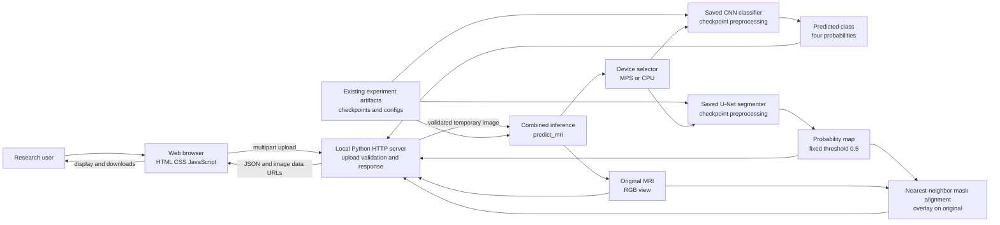
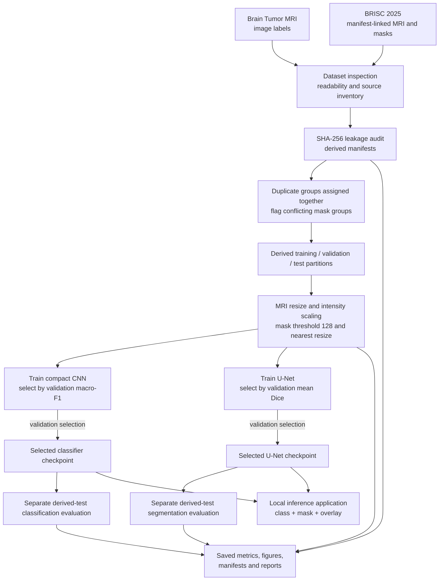

# System Architecture and End-to-End Workflow

These diagrams describe the implemented data/model path and local application.
The browser sends an uploaded image only to the local Python server; the server
calls the existing combined inference function and existing checkpoint-backed
prediction APIs.

## System architecture

The classifier and segmenter preprocess inputs independently using settings
saved with their respective checkpoints. The HTTP service validates supported
image types, file size and readability; validates output class-probability
mapping, configured threshold and image dimensions; and responds with
user-facing errors without returning stack traces or local paths.

## End-to-end data, training, and evaluation workflow

The test partitions are held out for the separate evaluation phase and are not
used to select model checkpoints. Classification uses only labeled
classification images. Segmentation uses BRISC image-mask pairs and excludes
the 46 flagged conflicting-mask rows. Pixel-level test metrics and class
classification metrics are reported separately in
[the experiment report](methodology_and_results.md).
